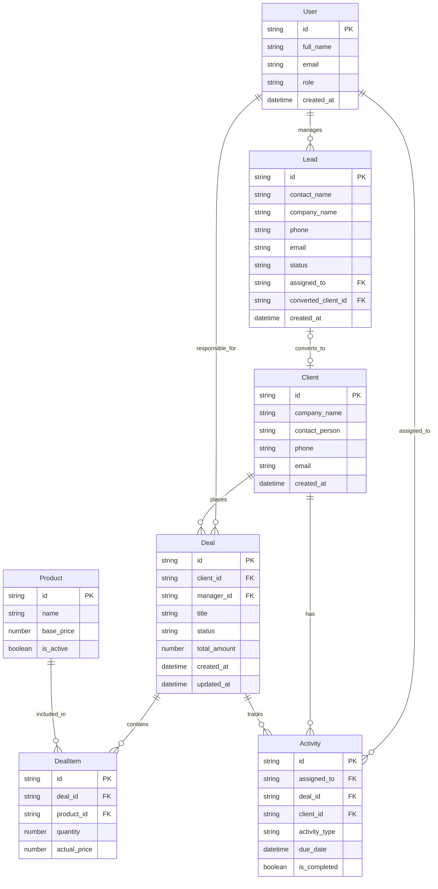

# Специфікація концептуальної моделі домену OpenCRM (spec.md)

---

## 1. Запити для ШІ (AI Prompts)

### Початковий промпт для генерації базової моделі:
```text
Створи концептуальну модель даних для OpenCRM у нотації Mermaid erDiagram.
Система повинна містити сутності для управління продажами:
- Співробітники (User)
- Потенційні клієнти (Lead)
- Клієнти (Client)
- Угоди (Deal)
- Продукти (Product)
- Позиції угод (DealItem)
- Активності / завдання (Activity)

Вимоги:
- Концептуальний рівень абстракції (без SQL DDL, без типів конкретних СКБД, типи: string, number, datetime, boolean).
- Текстовий опис сутностей, атрибутів із зазначенням PK/FK та зв'язків.
- Формалізовані критерії прийняття (Acceptance Criteria).
```

---

## 2. Словесний перелік сутностей, атрибутів та зв'язків

### 2.1. `User` (Співробітник / Менеджер)
Представляє внутрішнього користувача CRM-системи, який веде лідів, клієнтів та угоди.
* `id` : `string` [PK] — унікальний ідентифікатор співробітника.
* `full_name` : `string` — повне ім'я співробітника.
* `email` : `string` — корпоративна електронна адреса (унікальна).
* `role` : `string` — посадова роль (наприклад, `admin`, `manager`).
* `created_at` : `datetime` — дата та час реєстрації.

### 2.2. `Lead` (Лід / Потенційний клієнт)
Вхідний контакт або заявка, що ще не пройшла повну кваліфікацію.
* `id` : `string` [PK] — унікальний ідентифікатор ліда.
* `contact_name` : `string` — ім'я контактної особи.
* `company_name` : `string` — назва компанії (опціонально).
* `phone` : `string` — номер телефону.
* `email` : `string` — електронна адреса.
* `status` : `string` — поточний статус ліда (`new`, `contacted`, `qualified`, `disqualified`).
* `assigned_to` : `string` [FK] — посилання на відповідального менеджера (`User.id`).
* `converted_client_id` : `string` [FK] — посилання на клієнта після конвертації (`Client.id`, опціонально).
* `created_at` : `datetime` — дата створення ліда.

### 2.3. `Client` (Клієнт / Контрагент)
Кваліфікована компанія або особа, з якою ведуться комерційні відносини.
* `id` : `string` [PK] — унікальний ідентифікатор клієнта.
* `company_name` : `string` — офіційна назва компанії або контрагента.
* `contact_person` : `string` — контактна особа клієнта.
* `phone` : `string` — контактний телефон.
* `email` : `string` — контактний email.
* `created_at` : `datetime` — дата створення картки клієнта.

### 2.4. `Deal` (Угода / Продаж)
Комерційна можливість у воронці продажів.
* `id` : `string` [PK] — унікальний ідентифікатор угоди.
* `client_id` : `string` [FK] — посилання на клієнта (`Client.id`).
* `manager_id` : `string` [FK] — посилання на відповідального менеджера (`User.id`).
* `title` : `string` — назва або предмет угоди.
* `status` : `string` — етап воронки (`new`, `negotiation`, `contract`, `won`, `lost`).
* `total_amount` : `number` — загальна сума угоди.
* `created_at` : `datetime` — дата створення угоди.
* `updated_at` : `datetime` — дата останньої зміни.

### 2.5. `Product` (Товар / Послуга)
Каталог пропозицій компанії з базовими цінами.
* `id` : `string` [PK] — унікальний ідентифікатор продукту.
* `name` : `string` — назва товару або послуги.
* `base_price` : `number` — актуальна базова ціна в каталозі.
* `is_active` : `boolean` — ознака доступності для продажу.

### 2.6. `DealItem` (Позиція угоди — асоціативна сутність)
Конкретний товар або послуга, включена до угоди, з фіксацією ціни продажу.
* `id` : `string` [PK] — унікальний ідентифікатор позиції.
* `deal_id` : `string` [FK] — посилання на угоду (`Deal.id`).
* `product_id` : `string` [FK] — посилання на товар (`Product.id`).
* `quantity` : `number` — кількість одиниць.
* `actual_price` : `number` — ціна одиниці на момент продажу.

### 2.7. `Activity` (Активність / Комунікація)
Запланована або здійснена взаємодія (дзвінок, зустріч, лист).
* `id` : `string` [PK] — унікальний ідентифікатор активності.
* `assigned_to` : `string` [FK] — відповідальний менеджер (`User.id`).
* `deal_id` : `string` [FK] — посилання на угоду (`Deal.id`, опціонально).
* `client_id` : `string` [FK] — посилання на клієнта (`Client.id`, опціонально).
* `activity_type` : `string` — тип активності (`call`, `meeting`, `email`, `task`).
* `due_date` : `datetime` — запланована дата виконання.
* `is_completed` : `boolean` — стан виконання.

---

## 3. Критерії прийняття (Acceptance Criteria)

* **AC-01 (Рівень абстракції):** У моделі використовуються виключно концептуальні типи даних (`string`, `number`, `datetime`, `boolean`). Жодних фізичних SQL-типів (`VARCHAR`, `SERIAL`, `BIGINT`, `TIMESTAMP`).
* **AC-02 (Цілісність зв'язку угоди та клієнта):** Кожна угода (`Deal`) обов'язково належить рівно одному клієнту (`Client`). Клієнт може мати нуль або багато угод (`1 : 0..N`).
* **AC-03 (Зв'язок відповідальності менеджера):** Співробітник (`User`) може відповідати за кілька угод, клієнтів, лідів та активностей (`1 : 0..N`).
* **AC-04 (Асоціативна сутність для M:N):** Зв'язок між `Deal` та `Product` реалізується через асоціативну сутність `DealItem`, яка зберігає власні атрибути `quantity` та `actual_price`.
* **AC-05 (Історична незмінність вартості):** Поле `actual_price` у `DealItem` забезпечує фіксацію ціни продажу незалежно від подальших змін `base_price` у каталозі `Product`.
* **AC-06 (Конвертація ліда):** Лід (`Lead`) може опціонально посилатися на створеного з нього клієнта (`Client`).
* **AC-07 (Уніфікація ключів та типів):** Усі сутності мають концептуальний первинний ключ `id: string`. Усі зовнішні ключі мають тип `string` та суворо узгоджені назви.

---

## 4. Декларативний код ER-моделі (Mermaid — Базова версія)


