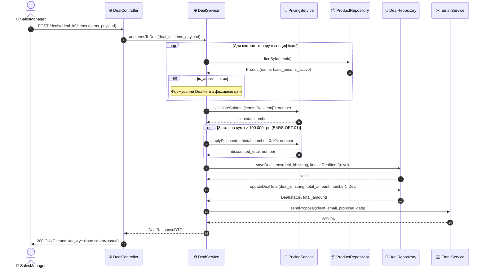

# Специфікація динамічної взаємодії OpenCRM (spec.md)

**Дисципліна:** Компоненти програмної інженерії | **Проєкт:** OpenCRM (Lab 3)  
**Артефакти:** [DEFENSE.md](DEFENSE.md) · [model.mermaid](model.mermaid) · [ADR 0001](adr/0001-layered-service-architecture.md) · [ai/prompts.md](ai/prompts.md)  

---

## 1. Контекст та намір сценарію
Сценарій реалізує наскрізний бізнес-процес **«Оформлення специфікації угоди з валідацією товарів, розрахунком знижки та надсиланням комерційної пропозиції»** (деталізація прецедентів `UC-2`, `UC-3`, `UC-4`, `UC-5`, `UC-6` та сценаріїв Gherkin `SC-01`, `SC-02` із Завдання 2).

---

## 2. Учасники взаємодії (Participants)
1. `SalesManager`: ініціатор процесу (автентифікований менеджер).
2. `DealController`: обробка вхідного HTTP-запиту, валідація DTO, повернення статус-коду.
3. `DealService`: координатор транзакції укладання угоди.
4. `PricingService`: ізольований сервіс фінансових калькуляцій та знижок.
5. `ProductRepository`: доступ до каталогу товарів `Product`.
6. `DealRepository`: збереження позицій `DealItem` та оновлення `Deal`.
7. `EmailService`: зовнішній поштовий шлюз.

---

## 3. Покроковий опис сценаріїв

### 3.1. Основний успішний сценарій (Happy Path)
1. `SalesManager` надсилає запит на додавання товарів до угоди (`deal_id`).
2. `DealController` передає запит у `DealService.addItemsToDeal()`.
3. У циклі `loop` для кожного товару `DealService` звертається до `ProductRepository` для перевірки `is_active`.
4. Товар активний: формується запис `DealItem` із фіксацією `actual_price = Product.base_price`.
5. `DealService` викликає `PricingService.calculateSubtotal()`.
6. У блоці `opt` (сума $> 100\,000$ грн за вимогою `EARS-OPT-01`) `PricingService.applyDiscount()` розраховує знижку.
7. `DealService` зберігає позиції та оновлює суму в `DealRepository`.
8. `DealService` ініціює асинхронне надсилання комерційної пропозиції через `EmailService`.
9. `DealController` повертає менеджеру `200 OK` зі сформованими даними угоди.

### 3.2. Альтернативний сценарій помилки: Товар неактивний (Error Path)
* Якщо хоча б один товар має статус `is_active == false`, система негайно перериває процес, генерує виняток `400 Bad Request` і не зберігає зміни в БД.

---

## 4. Критерії прийняття (Acceptance Criteria)
* **AC-01 (Повнота учасників):** Модель містить повний набір компонентів архітектури: актор, контролер, сервіси, репозиторії та зовнішній API.
* **AC-02 (Напрямок та тип викликів):** Усі синхронні виклики супроводжуються обов'язковими return-стрілками (`-->>`) та типізованими сигнатурами.
* **AC-03 (Обробка винятків):** Наявна обов'язкова обробка бізнес-помилки в блоці `alt` / `else` з перериванням транзакції.
* **AC-04 (Керуючі структури):** Діаграма містить усі обов'язкові блоки: `loop` (ітерація замовлення), `opt` (знижка), `alt`/`else` (валідація).
* **AC-05 (Наскрізна узгодженість із Lab 1):** Усі сигнатури оперують сутностями та полями з ER-моделі (`product_id`, `actual_price`, `quantity`, `total_amount`).
* **AC-06 (Синхронізація з Lab 2):** Логіка викликів строго повторює послідовність кроків `UC-2`, `UC-3`, `UC-4`, `UC-5`, `UC-6` та сценарію `SC-01`.

---

## 5. Декларативний код Sequence Diagram (Mermaid — Базова версія)

